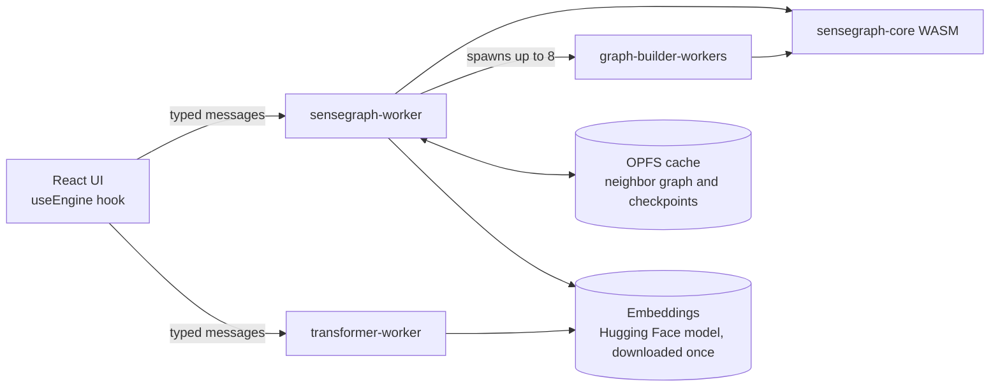

# SenseGraph

**An idea path for cutting inference cost: can a graph computed once from an existing model replace some of the work attention does at query time?** SenseGraph takes the embedding table of a pre-trained language model, precomputes a nearest-neighbor graph over it, and answers retrieval-style queries by graph lookup instead of a full vocabulary scan. This repository is the first working demo of that idea, and it is explicit about what it does and does not show yet.

## The Core Idea

Modern language models have two main parts:

1. **Embedding layer** - a lookup table mapping each token to a high-dimensional vector. Much of what the model learned about which tokens relate to each other is stored here.

2. **Attention layers** (22 to 96 in typical models) - compute pairwise interactions between all tokens in the input, costing O(n^2 x d) per layer at query time. This is where most of the inference compute, and so most of the GPU use, goes.

**The hypothesis:** for some tasks, such as similarity and semantic retrieval, the embedding layer already holds enough knowledge, and structure computed once from it (a neighbor graph) can answer queries more cheaply than computing attention and scanning the vocabulary on every query. This is a hypothesis. The demo tests the narrowest version of it, nearest-token and phrase retrieval over static embeddings. See "Limitations" and "Future directions" for what is not covered.

## How It Works

```
Conventional path (per query):
  Input -> Tokenize -> [Attention layers] -> scan whole vocabulary -> Top K

SenseGraph path (graph built once, then per query):
  Input -> Tokenize -> neighbor graph lookup -> score a few candidates -> Top K
```

In the demo the baseline is a simulated single attention pass followed by a full vocabulary scan. It is a cost model, not a real multi-layer forward pass.

### Step 1: Extract Embeddings

The app reads the safetensors header of a Hugging Face model and downloads only the embedding rows it needs with HTTP range requests, together with the tokenizer. That is roughly 57 MB for SmolLM2 135M and about 90 MB for the first 50K tokens of a Qwen model, not the whole multi-gigabyte file.

### Step 2: Build Neighbor Graph (one-time)

For each token in the vocabulary, SenseGraph precomputes its 20 nearest neighbors by cosine similarity. A single-token query then needs one lookup. The build runs once per model, in parallel web workers, and is cached.

### Step 3: Query via Graph Lookup

A single token is answered by reading its precomputed neighbors. For a phrase, the neighbor lists of its tokens form the candidate set, and only those candidates are scored against the mean of the normalized token vectors.

## Architecture

### Monorepo layout (Nx)

```
SenseGraph/
  apps/
    cli/          Node.js REPL, loads the engine as WASM
    web/          React benchmark app, baseline vs SenseGraph side by side
  libs/
    core/         Rust engine (sensegraph-core), compiled to WASM
  tools/
    scripts/      embedding extraction and import tools
    copy-wasm.mjs copies the web build of the engine next to the static assets
  data/           embeddings and tokenizers (not in git)
```

Nx projects: `core`, `cli` and `web`. The `cli` and `web` projects depend on the
matching WASM build of `core`, so `nx build web` and `nx test cli` build the
engine first and cache the result.

### The engine (libs/core)

- **vectors**: a vector store that loads embeddings as f16, bf16 or f32 and keeps
  them as f32 with precomputed norms. It provides cosine similarity, top-K search
  for one word, several words or weighted words, and the **neighbor graph**: the
  K nearest neighbors of every word, built in batches, exportable, importable
  and mergeable so several workers can build ranges in parallel.
- **graph**: a semantic graph of word, sense and concept nodes. Edges link senses
  to context indicator words and to related nodes. It powers word sense
  disambiguation.
- **engine**: a tokenizer (whitespace and punctuation split, stop words) and a
  resolver. For each word with more than one sense, the resolver looks at the
  surrounding tokens (a window of 5) and scores each sense by how many of its
  context indicators appear. Each token resolves to a literal, an unambiguous
  sense, a disambiguated sense with alternatives, or an ambiguous set.
- **bridge**: the `wasm-bindgen` surface. Graphs and stores are addressed by
  integer handles, and results cross the boundary as serialised values.

The web build is compiled with SIMD128 enabled.

### The CLI (apps/cli)

A TypeScript REPL. It loads the WASM build for Node.js, the embeddings and the
tokenizer from `data/`, seeds the semantic graph with example senses (bank,
crane, bat, bass and so on), and offers `similar`, `compare` and `search`
commands. A plain sentence is resolved word by word.

### The web app (apps/web)



- **sensegraph-worker** loads the WASM module, the tokenizer and the embeddings,
  then either restores the neighbor graph from OPFS or builds it with up to 8
  parallel graph-builder workers (K = 20, batches of 500). Progress is
  checkpointed to OPFS, so an interrupted build resumes where it stopped. A
  single-token query is one neighbor lookup. A multi-token query takes the union
  of the neighbor lists of its tokens as candidates and scores only those against
  the mean of the normalized token vectors.
- **transformer-worker** is the baseline. For each query it simulates one
  attention pass over the query tokens (Q, K and V from the embeddings, scaled
  dot-product scores, softmax, weighted sum), then scans the whole vocabulary
  against the same mean vector, keeping the best K. It reports the arithmetic
  operations it performed.
- **Models**: pick a model from the dropdown. Code models (Qwen2.5-Coder) are
  listed first and are the default; general models are also available. The app
  reads the safetensors header from Hugging Face and fetches only the embedding
  rows it uses with HTTP range requests, so nothing is bundled with the site. For
  models with a very large vocabulary only the first 50,000 tokens (the most
  frequent ones) are indexed.
- **Tokenizers**: byte level BPE (Qwen, SmolLM), SentencePiece style BPE
  (TinyLlama, Phi) and plain word lists are supported, so every model in the
  dropdown tokenizes its input correctly.
- **Query types**: intent search for a phrase, related tokens, and compare two
  terms. Example queries adapt to the model type (code or general).
- **Complex task suite**: twelve longer multi-token queries run through both
  engines, each timed three times. For every query the input tokens, both
  engines' top results, the top-10 overlap and the speedup are shown.
- A continuous benchmark with live latency charts and architecture diagrams.

### How to read the benchmark

The selected model is downloaded once in the page. The same tokenizer and
embedding tensor are then handed to both engines, so they process identical
input and are asked for the same ranking. Single-token queries should match
exactly. For multi-token queries SenseGraph only scores candidates taken from
neighbor lists, so the page reports the top-10 overlap with the exact scan
instead of assuming it is 100%. For search queries both engines drop stop words (shown struck through in the token list)
before building the query vector, so they answer the same question, and SenseGraph runs one
refinement round that also scores the neighbors of its best candidates. The neighbor
graph cached in OPFS is keyed by model, so switching models never reuses another
model's graph. The comparison measures a precomputed neighbor lookup against a
brute-force scan of the vocabulary plus a simulated attention step. It does not
run a full multi-layer transformer, and the "22 layers" figures are a cost
model, not a measurement of a real model.

## Benchmark Results

Measured in the live app with SmolLM2 135M (49,152 tokens, 576 dimensions) and 8 worker threads. Results differ per model and machine.

| Metric | Baseline (simulated attention + scan) | SenseGraph |
|--------|-------------|------------|
| Average over 48 mixed queries | 59.3 ms | 1.4 ms |
| 95th percentile | 96.4 ms | 3.7 ms |
| Speedup over the run | 1x | about 43x |
| Top 10 overlap with the exact scan | reference | 100% on the queries checked |
| One-time graph build | - | 114 s, 7.5 MB graph |

The overlap compares the graph with an exact scan of the same vectors, so it shows the graph is a faithful shortcut for retrieval. It does not show that results match a real model's outputs. The speedup comes from precomputation, not from the browser: the same approach would run in Node, natively or on a server.

## Strengths

1. **Much faster retrieval** - a graph lookup plus scoring a small candidate set, against a vocabulary scan. About 43x on average in the run above, against a simulated baseline.

2. **No GPU needed for the lookup** - it runs on CPU in WASM, with no CUDA, no GPU memory and no drivers, in any modern browser.

3. **Small footprint** - only the embedding rows are downloaded, and the graph adds a few megabytes (7.5 MB for SmolLM2 135M).

4. **Predictable latency for single tokens** - a single-token query is one lookup, independent of input length.

5. **Works offline** - once the model rows and graph are cached in the browser (OPFS), no network is needed.

6. **Parallel, resumable build** - the graph is built by 8 workers and checkpoints to OPFS, so an interrupted build resumes.

## Limitations

Each limitation is listed with its status in this repository.

1. **No contextual understanding.** Attention lets a word's meaning change with its neighbors ("bank" in "river bank" versus "bank account"). SenseGraph uses one static vector per token, so both senses share a vector. The Rust core and the CLI include a rule-based sense resolver that picks a sense of an ambiguous word from context indicator words (for example "river" versus "money" around "bank"). It only works for the few words whose senses and indicators are added by hand (see `apps/cli/src/knowledge/seed.ts`), it is not used by the web benchmark, and it is much weaker than attention. Direction: learn the indicators from text instead of hand-seeding them, a hybrid mode with a small transformer for reranking, and graphs derived from deeper layers of a model, which carry some context.

2. **No text generation.** The engine retrieves and ranks. It is a search engine over embeddings, not a language model, and it does not generate text.

3. **No word order.** A phrase is scored against the mean of its tokens' normalized vectors, so "the cat sat on the mat" and "the mat sat on the cat" score identically. Direction: phrase or n-gram nodes in the graph, and positional weighting.

4. **One-time build cost.** The graph is built once per model: 114 s for 49,152 tokens at 576 dimensions on 8 workers. The all-pairs search grows roughly with the square of the vocabulary size and linearly with the embedding dimension, so a vocabulary twice the size would take about four times as long, an estimate that has not been measured. The app caps large vocabularies at the first 50,000 tokens to keep the build practical. Direction: WebGPU compute for the build, or an approximate nearest-neighbor index in place of the exact all-pairs search.

5. **Vocabulary coverage.** The byte-level BPE tokenizers cover any input through byte fallback, so there is no true out-of-vocabulary failure, but a rare word is split into sub-word tokens whose vectors are averaged. For models with vocabularies above 50,000 tokens, only the first 50,000 rows are indexed, so tokens beyond that are not searchable. Direction: a larger cap with a faster build.

6. **Phrase queries are an approximation.** Averaging constituent vectors loses compositional meaning ("hot dog" is not the average of "hot" and "dog"), and because only candidates from the tokens' neighbor lists are scored, an exact scan could in principle find something the graph misses. The app reports the top 10 overlap with the exact scan for every query so this can be checked.

7. **Not yet compared with real model outputs.** The baseline is a cost model, and the overlap is measured against the same embedding table. A comparison against real model outputs or a standard retrieval benchmark has not been done, and neither has a measurement of real GPU savings.

## When to Use SenseGraph Instead of Transformers

| Use Case | SenseGraph | Transformer |
|----------|-----|-------------|
| Word similarity / analogies | Good | Overkill |
| Semantic search over short queries | Good | Good but slower |
| Document retrieval / ranking | Plausible, untested | Better for complex queries |
| Word sense disambiguation | Limited: hand-seeded rules in the CLI only | Better (with attention) |
| Text generation | Not possible | Required |
| Chatbots / conversation | Not possible | Required |
| Translation | Not possible | Required |
| Summarization | Not possible | Required |

**SenseGraph is best suited to:** retrieval, similarity and nearest-match lookups over a vocabulary, where it should be fast, work offline and need no GPU.

**Transformers are still needed for:** anything that depends on word order or context, generating text, or reasoning about novel combinations of concepts.

## Quick Start

Requirements: Node.js 22 or later, a stable Rust toolchain with the
`wasm32-unknown-unknown` target, and [wasm-pack](https://rustwasm.github.io/wasm-pack/).

```bash
npm install
```

### CLI

```bash
# Downloads the embedding tensor and tokenizer of a Hugging Face model into data/
npm run extract

# Build the engine for Node.js and start the REPL
npm run wasm:node
npm start
```

```
SenseGraph> similar <token>
SenseGraph> compare <token> <token>
SenseGraph> search <phrase>
```

The results depend on the model whose embeddings were extracted.


### Browser benchmark

```bash
# Builds the WASM engine for the web, then starts Vite
npm run dev
```

Open http://localhost:5173, select a model, click Load, and compare the two
engines side by side.

### Nx commands

```bash
npx nx run-many -t test typecheck build   # everything
npx nx test core                          # Rust tests
npx nx test cli                           # TypeScript tests
npx nx build web                          # production build of the web app
npx nx graph                              # project dependency graph
```

## Access and publishing

This repository is public. The web app is deployed to GitHub Pages at
https://pixytech.github.io/SenseGraph/ and listed on the Pixytech portal as a
public app.

- `portal.json` marks the app as `public` and points at the Pages URL.
- `.github/workflows/ci.yml` tests, typechecks and builds every project, then its
  deploy job publishes the web app (built with the base path `/SenseGraph/`) to
  GitHub Pages when the build passes on `main`.

One-time setup: in the repository settings, set Pages to deploy from GitHub
Actions, and add this repository to the Pixytech Portal GitHub App.

## Supported Models

| Model | Type | Embedding download | Tokenizer |
|-------|------|--------------------|-----------|
| Qwen2.5-Coder 0.5B (default) | Code | ~90 MB (first 50K tokens) | byte level BPE |
| Qwen2.5-Coder 1.5B | Code | ~155 MB (first 50K tokens) | byte level BPE |
| SmolLM2 135M | General | ~57 MB | byte level BPE |
| SmolLM2 360M | General | ~95 MB | byte level BPE |
| Qwen 2.5 0.5B | General | ~90 MB (first 50K tokens) | byte level BPE |
| TinyLlama 1.1B Chat | General | ~130 MB | SentencePiece BPE |
| Phi 3.5 Mini | General | ~200 MB | SentencePiece BPE |

## Technology Stack

- **Rust** - core vector math, compiled to WASM with SIMD128
- **TypeScript** - CLI host, React UI, BPE tokenizer
- **WebAssembly** - runs in browser and Node.js
- **Web Workers** - parallel graph building (8 threads)
- **OPFS** - persistent graph cache in browser
- **Vite + React** - benchmark UI

## Future directions

Status is as of this version.

| Direction | Status |
|-----------|--------|
| Real LLM embedding extraction from safetensors | Done. The app range-reads the embedding tensor of seven models from Hugging Face. |
| Streaming model loading | Partly done. Only the embedding rows are fetched, so model size is not the limit. Still open: multi-shard models beyond the first shard, and vocabularies above 50,000 tokens. |
| Compare against real model outputs | Not started. Needed to show quality, not only a faithful shortcut. |
| Measure real GPU cost against a real forward pass | Not started. Needed to support the GPU-saving claim. |
| Hybrid mode: SenseGraph retrieval plus a small transformer reranker | Not started. The main answer to the context limitation. |
| Context-aware graphs from deeper model layers | Not started. A research direction, not a result. |
| Phrase and n-gram nodes, positional weighting | Not started. Addresses word order and compositional phrases. |
| WebGPU compute for the graph build | Not started. Speedup over CPU is a goal, not a measurement. |
| Approximate nearest-neighbor index for the build | Not started. Would reduce the quadratic build cost. |
| Batched candidate scoring in the Rust core | Done. `score_candidates` scores a whole candidate list in one WASM call, with one dot product per candidate. It replaces about a thousand small calls per phrase query. |
| Learning context indicators from text corpora | Not started. Today they are added by hand for a few words in the CLI. |
