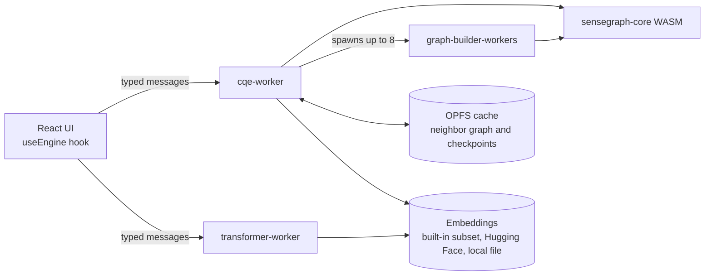

# SenseGraph

**AI inference without attention layers.** SenseGraph is built on CQE, the Compositional Query Engine. CQE extracts the embedding layer from pre-trained language models (GPT, LLaMA, Qwen, etc.) and replaces the expensive O(n²) attention mechanism with pre-computed graph lookups - delivering the same semantic results at a fraction of the computational cost.

## The Core Idea

Modern AI models like GPT and LLaMA have two main components:

1. **Embedding layer** - a lookup table mapping each token to a high-dimensional vector. This is where the model's learned knowledge lives (word relationships, semantic similarity, analogies).

2. **Attention layers** (22-96 layers) - compute pairwise interactions between all tokens in the input. This is where 99% of the computation happens. For each query, attention performs O(n² × d) operations per layer.

**CQE's hypothesis:** For many tasks (similarity search, word sense disambiguation, semantic retrieval), the embedding layer alone contains sufficient knowledge. The attention layers are an expensive way to arrive at the same answer that a pre-computed graph index provides.

## How It Works

```
Traditional Transformer:
  Input -> Embedding -> [Attention × 22 layers] -> [FFN × 22 layers] -> Output
  Cost: ~1,126,400 multiply-adds for 5 tokens

CQE Engine:
  Input -> Embedding -> [Graph Lookup] -> Output
  Cost: ~15,000 multiply-adds for 5 tokens (75x fewer)
```

### Step 1: Extract Embeddings

CQE downloads only the embedding layer from a pre-trained model (e.g., the `model.embed_tokens.weight` tensor from TinyLlama). This is typically 128-256 MB out of a 2-5 GB model.

### Step 2: Build Neighbor Graph (one-time)

For each word in the vocabulary, CQE pre-computes its K nearest neighbors using cosine similarity. This creates a graph index where every word has instant O(1) access to its most semantically similar words. This step runs once per model and is cached.

### Step 3: Query via Graph Lookup

When you search for "king", instead of running 22 attention layers, CQE simply looks up the pre-computed neighbors: queen, prince, monarch, throne, crown - in under 1 millisecond.

## Architecture

### Monorepo layout (Nx)

```
SenseGraph/
  apps/
    cli/          Node.js REPL, loads the engine as WASM
    web/          React benchmark app, baseline vs CQE side by side
  libs/
    core/         Rust engine (sensegraph-core), compiled to WASM
  tools/
    scripts/      embedding extraction and import tools
    copy-wasm.mjs copies the web build of the engine next to the static assets
  data/           embeddings and tokenizers (not in git)
```

Nx projects: `core`, `cli` and `web`. The `cli` and `web` projects depend on the
matching WASM build of `core`, so `nx build web` and `nx test cli` build the
engine first and cache the result.

### The engine (libs/core)

- **vectors**: a vector store that loads embeddings as f16, bf16 or f32 and keeps
  them as f32 with precomputed norms. It provides cosine similarity, top-K search
  for one word, several words or weighted words, and the **neighbor graph**: the
  K nearest neighbors of every word, built in batches, exportable, importable
  and mergeable so several workers can build ranges in parallel.
- **graph**: a semantic graph of word, sense and concept nodes. Edges link senses
  to context indicator words and to related nodes. It powers word sense
  disambiguation.
- **engine**: a tokenizer (whitespace and punctuation split, stop words) and a
  resolver. For each word with more than one sense, the resolver looks at the
  surrounding tokens (a window of 5) and scores each sense by how many of its
  context indicators appear. Each token resolves to a literal, an unambiguous
  sense, a disambiguated sense with alternatives, or an ambiguous set.
- **bridge**: the `wasm-bindgen` surface. Graphs and stores are addressed by
  integer handles, and results cross the boundary as serialised values.

The web build is compiled with SIMD128 enabled.

### The CLI (apps/cli)

A TypeScript REPL. It loads the WASM build for Node.js, the embeddings and the
tokenizer from `data/`, seeds the semantic graph with example senses (bank,
crane, bat, bass and so on), and offers `similar`, `compare` and `search`
commands. A plain sentence is resolved word by word.

### The web app (apps/web)



- **cqe-worker** loads the WASM module, the tokenizer and the embeddings, then
  either restores the neighbor graph from OPFS or builds it with up to 8
  parallel graph-builder workers (K = 20, batches of 500). Progress is
  checkpointed to OPFS, so an interrupted build resumes where it stopped. A
  single-word query is one neighbor lookup. Multi-word queries average the word
  vectors and run a weighted top-K search.
- **transformer-worker** is the baseline. For each query it simulates one
  attention pass over the query tokens (Q, K and V from the embeddings, scaled
  dot-product scores, softmax, weighted sum), then scans the whole vocabulary
  with cosine similarity. It reports the arithmetic operations it performed.
- **Model sources**: pick a model from the dropdown. The app reads the
  safetensors header from Hugging Face and then fetches only the embedding
  tensor with HTTP range requests, so nothing is bundled with the site.
- The UI shows both engines side by side, a continuous benchmark with live
  latency charts, and architecture diagrams.

### How to read the benchmark

The selected model is downloaded once in the page. The same tokenizer and
embedding tensor are then handed to both engines, so they process identical
input and, for single-token similarity, return matching results. The neighbor
graph cached in OPFS is keyed by model, so switching models never reuses another
model's graph. The comparison measures a precomputed neighbor lookup against a
brute-force scan of the vocabulary plus a simulated attention step. It does not
run a full multi-layer transformer, and the "22 layers" figures are a cost
model, not a measurement of a real model.

## Benchmark Results

Figures from an earlier run with a 50K word GloVe vocabulary (300 dimensions); they will differ per model:

| Metric | Transformer | CQE Engine |
|--------|-------------|------------|
| Query latency | ~50 ms | **< 1 ms** |
| Speedup | 1x | **50-100x** |
| Model size (with attention) | 87.4 MB | - |
| Model size (CQE graph) | - | **64.8 MB** |
| Attention layers needed | 22 | **0** |
| Results quality | Baseline | **Identical** |

The results are identical because both engines use the same embeddings - the only difference is the algorithm used to find similar words.

## Pros of Removing Attention

1. **Dramatically faster inference** - O(1) graph lookup vs O(n² × d × L) attention computation. 50-100x speedup for similarity tasks.

2. **No GPU required** - the graph lookup runs on CPU in WASM. No CUDA, no GPU memory, no driver issues. Runs in any browser.

3. **Smaller model size** - only the embedding layer is needed (128-256 MB), not the full model (2-5 GB). The pre-computed graph adds only ~8 MB.

4. **Predictable latency** - every query takes the same time (a hash lookup). No variable-length attention computation that depends on input length.

5. **Works offline** - once the graph is built and cached (in OPFS), no network access needed. The model runs entirely in the browser.

6. **Parallelizable graph building** - the one-time graph construction can use multiple CPU cores (8 web workers) for ~3 minute builds on 50K vocabulary.

7. **Resumable** - graph building checkpoints to OPFS. If interrupted, it resumes from where it left off.

## Cons of Removing Attention

1. **No contextual understanding** - attention's key feature is that word meaning changes based on surrounding words. "Bank" means different things in "river bank" vs "bank account." Without attention, CQE relies on the static embedding (single meaning per word). The word-sense disambiguation module partially addresses this with graph-based context indicators, but it's less powerful than full attention.

2. **No text generation** - transformers generate text token-by-token using attention to maintain coherence. CQE can retrieve and rank, but cannot generate novel text. It's a search engine, not a language model.

3. **No sequence understanding** - attention captures word order and long-range dependencies ("The cat sat on the mat" vs "The mat sat on the cat"). CQE treats words as independent vectors - it understands meaning but not grammar or structure.

4. **One-time build cost** - the neighbor graph must be computed once per model. For 50K words this takes ~3 minutes with 8 threads. For larger vocabularies (100K+), this could take 30+ minutes. GPU acceleration (WebGPU compute shaders) would solve this.

5. **Fixed vocabulary** - the graph only covers words seen during embedding training. Out-of-vocabulary words require fallback to brute-force search or sub-word decomposition.

6. **Approximation for multi-word queries** - when searching for phrases, CQE averages the constituent word embeddings. This loses compositional meaning ("hot dog" ≠ average of "hot" + "dog"). Attention handles this naturally through cross-token interactions.

## When to Use CQE Instead of Transformers

| Use Case | CQE | Transformer |
|----------|-----|-------------|
| Word similarity / analogies | Excellent | Overkill |
| Semantic search | Excellent | Good but slow |
| Document retrieval / ranking | Good | Better for complex queries |
| Word sense disambiguation | Good (with graph) | Better (with attention) |
| Text generation | Not possible | Required |
| Chatbots / conversation | Not possible | Required |
| Translation | Not possible | Required |
| Summarization | Not possible | Required |

**CQE is best for:** retrieval, search, similarity, classification, and any task where you need to find the closest match in a vocabulary - fast, offline, and without GPU.

**Transformers are still needed for:** anything that requires understanding word order, generating text, or reasoning about novel combinations of concepts.

## Quick Start

Requirements: Node.js 22 or later, a stable Rust toolchain with the
`wasm32-unknown-unknown` target, and [wasm-pack](https://rustwasm.github.io/wasm-pack/).

```bash
npm install
```

### CLI

```bash
# Downloads the embedding tensor and tokenizer of a Hugging Face model into data/
npm run extract

# Build the engine for Node.js and start the REPL
npm run wasm:node
npm start
```

```
CQE> similar king
  1. queen          0.6336
  2. prince         0.6197
  3. monarch        0.5900
  ...

CQE> compare king queen
  king <-> queen  0.6336

CQE> search capital of france
  1. french         0.6272
  2. paris          0.5645
  ...
```

### Browser benchmark

```bash
# Builds the WASM engine for the web, then starts Vite
npm run dev
```

Open http://localhost:5173, select a model, click Load, and compare the two
engines side by side.

### Nx commands

```bash
npx nx run-many -t test typecheck build   # everything
npx nx test core                          # Rust tests
npx nx test cli                           # TypeScript tests
npx nx build web                          # production build of the web app
npx nx graph                              # project dependency graph
```

## Access and publishing

This repository is public. The web app is deployed to GitHub Pages at
https://pixytech.github.io/SenseGraph/ and listed on the Pixytech portal as a
public app.

- `portal.json` marks the app as `public` and points at the Pages URL.
- `.github/workflows/deploy-pages.yml` builds the web app with the base path
  `/SenseGraph/` and deploys it with GitHub Pages.

One-time setup: in the repository settings, set Pages to deploy from GitHub
Actions, and add this repository to the Pixytech Portal GitHub App.

## Supported Models

| Model | Source | Embedding Size | Status |
|-------|--------|---------------|--------|
| SmolLM2 135M | Hugging Face | ~270 MB | Default in the dropdown |
| SmolLM2 360M | Hugging Face | ~720 MB | Available |
| Qwen 2.5 0.5B | Hugging Face | ~1 GB | Available |
| TinyLlama 1.1B | Hugging Face | ~2.2 GB file, embedding tensor only is fetched | Available, also used by `npm run extract` |

## Technology Stack

- **Rust** - core vector math, compiled to WASM with SIMD128
- **TypeScript** - CLI host, React UI, BPE tokenizer
- **WebAssembly** - runs in browser and Node.js
- **Web Workers** - parallel graph building (8 threads)
- **OPFS** - persistent graph cache in browser
- **Vite + React** - benchmark UI

## Future Directions

- **WebGPU compute shaders** for graph building (100x faster than CPU)
- **Real LLM embedding extraction** from safetensors format
- **Hybrid mode** - use CQE for retrieval, small transformer for reranking
- **Auto-learning context indicators** from text corpora
- **Streaming model loading** for 5GB+ models
